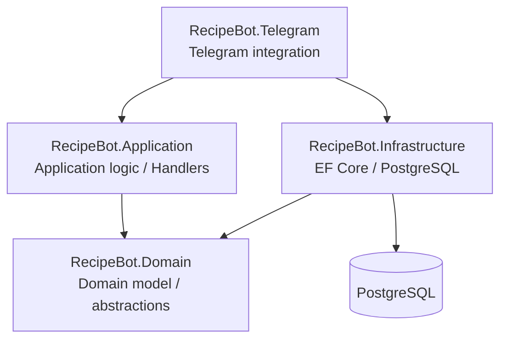
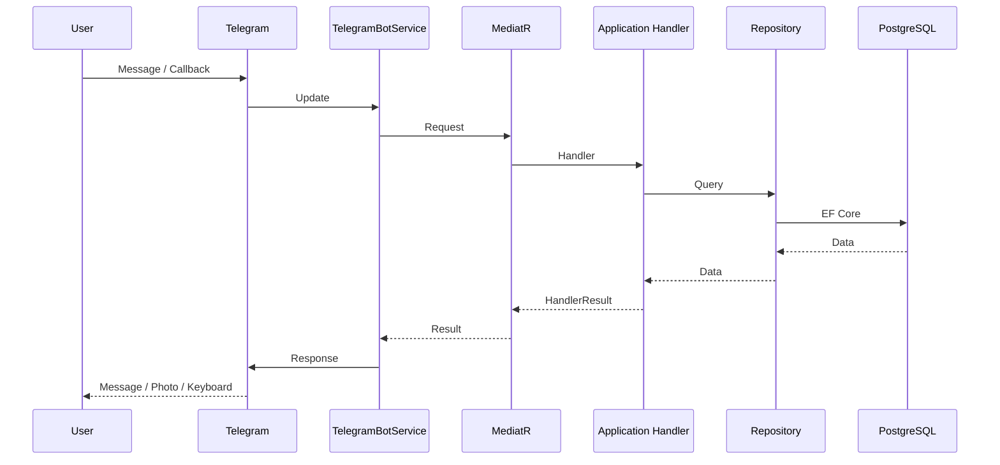
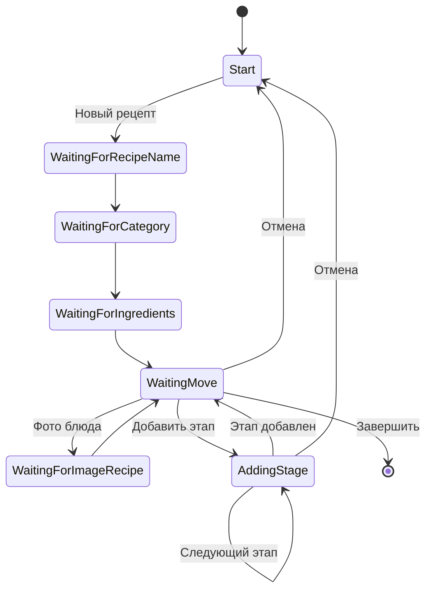
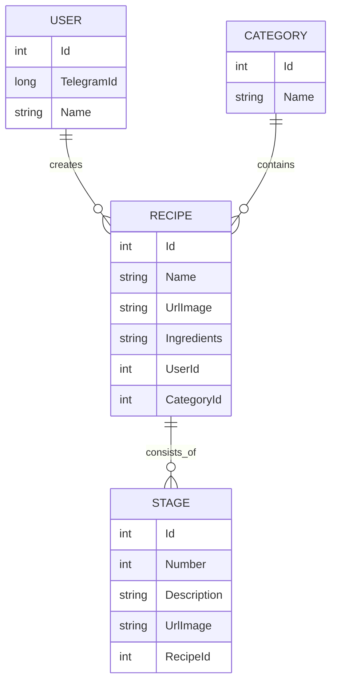

# 🍳 Recipe Telegram Bot

> Telegram-бот для создания, хранения и просмотра рецептов с пошаговым описанием приготовления и фотографиями.

[](https://dotnet.microsoft.com/)
[](https://learn.microsoft.com/dotnet/csharp/)
[](https://www.postgresql.org/)
[](https://learn.microsoft.com/ef/core/)
[](https://www.docker.com/)
[](https://core.telegram.org/bots/api)
[](#архитектура)

---

## 📌 О проекте

**Recipe Telegram Bot** — pet-проект на современном .NET, предназначенный для создания и хранения рецептов непосредственно через Telegram.

Пользователь взаимодействует с ботом пошагово:

* создаёт новый рецепт;
* указывает название;
* выбирает категорию;
* добавляет ингредиенты;
* добавляет фотографию блюда;
* создаёт этапы приготовления;
* при необходимости добавляет фотографию к каждому этапу;
* сохраняет рецепт;
* просматривает ранее созданные рецепты;
* ищет рецепты;
* фильтрует рецепты по категории;
* просматривает этапы приготовления;
* удаляет рецепты.

Основная задача проекта — не только интеграция с Telegram Bot API, но и практическое применение современных подходов backend-разработки:

* Clean Architecture;
* Dependency Injection;
* MediatR;
* Entity Framework Core;
* PostgreSQL;
* Repository pattern;
* state-based пользовательские сценарии;
* доменная инкапсуляция;
* BackgroundService;
* асинхронное программирование;
* Docker.

Несмотря на небольшой предметный домен, проект использует полноценное разделение ответственности между слоями приложения и демонстрирует работу с:

* внешним API;
* базой данных;
* пользовательскими сценариями;
* состоянием приложения;
* асинхронным программированием;
* контейнеризацией.

Проект предназначен для учебных и портфолио-целей.

---

# ✨ Возможности

## 📝 Создание рецепта

Пользователь проходит последовательный сценарий создания:

```text
/start
   │
   ▼
┌─────────────────────┐
│    Главное меню     │
└──────────┬──────────┘
           │
           ▼
      Новый рецепт
           │
           ▼
    Название рецепта
           │
           ▼
        Категория
           │
           ▼
       Ингредиенты
           │
           ▼
      Фото блюда
       (опционально)
           │
           ▼
  Этапы приготовления
           │
           ▼
       Завершение
           │
           ▼
      PostgreSQL
```

Поддерживается:

* создание рецепта;
* выбор категории;
* добавление ингредиентов;
* добавление фотографии блюда;
* добавление одного или нескольких этапов;
* добавление фотографии к этапу;
* завершение создания рецепта;
* сохранение рецепта в PostgreSQL.

---

## 📚 Мои рецепты

В разделе **«Мои рецепты»** пользователь может работать с уже сохранёнными рецептами.

Доступны:

* просмотр всех своих рецептов;
* поиск по полному или частичному названию;
* фильтрация по категории;
* постраничная навигация;
* выбор конкретного рецепта;
* просмотр информации о рецепте;
* просмотр этапов приготовления;
* удаление рецепта.

---

## 🔎 Поиск рецептов

Поддерживается поиск рецептов по полному или частичному названию.

Например:

```text
Введите полное и частичное наименование рецепта.
```

После выполнения поиска пользователь получает список найденных рецептов с постраничной навигацией.

---

## 📂 Фильтрация по категории

Пользователь может выбрать категорию и получить список принадлежащих ей рецептов.

Пример:

```text
📂 Выберите категорию

[ Супы ]
[ Салаты ]
[ Выпечка ]
[ Десерты ]
```

---

## 📄 Пагинация

Список рецептов разбивается на страницы.

Для навигации используются callback-данные:

```text
recipes:page:0
recipes:page:1
recipes:page:2
```

Выбор конкретного рецепта использует отдельный callback:

```text
recipe:view:15
```

Для просмотра конкретного этапа:

```text
recipe:stage:15:2
```

Где:

```text
15 — идентификатор рецепта
2  — индекс этапа
```

Такой подход позволяет однозначно определить действие пользователя без необходимости хранить номер страницы или выбранный рецепт в каждом callback.

---

## 📖 Просмотр рецепта

После выбора рецепта пользователь получает основную информацию:

```text
🍲 Борщ

📂 Категория: Супы

🥕 Ингредиенты:
Картофель
Морковь
Свёкла
Капуста
...

👨‍🍳 Этапов приготовления: 6

[ 👁️ Просмотреть этапы ]
[ 🗑️ Удалить ]
[ ↩️ Назад ]
```

---

## 👨‍🍳 Просмотр этапов

Этапы отображаются последовательно.

```text
👨‍🍳 Борщ — этап 1 / 6

Нарезать овощи и подготовить мясо.

◀️    1 / 6    ▶️

[ ↩️ К рецепту ]
```

Для навигации используется callback:

```text
recipe:stage:{recipeId}:{stageIndex}
```

Если у этапа есть фотография, она отправляется вместе с описанием.

---

## 📷 Работа с фотографиями

Фотография может быть добавлена:

* к самому рецепту;
* к отдельному этапу приготовления.

Фото этапа **не является самостоятельным этапом**.

Корректный сценарий:

```text
📝 Описание этапа
        +
📷 Фотография
        ↓
    Один Stage
```

Таким образом, каждый этап всегда содержит описание, а фотография является дополнительными данными.

---

# 🏗 Архитектура

Проект построен с использованием принципов **Clean Architecture** и разделён на несколько слоёв.



## Слои проекта

### `RecipeBot.Domain`

Содержит бизнес-модель приложения и абстракции:

* `User`;
* `Recipe`;
* `Stage`;
* `Category`;
* интерфейсы репозиториев;
* состояния пользовательских сценариев.

Доменный слой не зависит от конкретной базы данных.

---

### `RecipeBot.Application`

Содержит прикладные сценарии и application logic.

Основные компоненты:

* `AddNewRecipeHandler`;
* `GetUserRecipesHandler`;
* `StartMenuHandler`;
* `GetOrCreateUserHandler`;
* `UserSession`;
* `HandlerResult`;
* пагинация рецептов;
* пагинация этапов.

Для маршрутизации application-сценариев используется **MediatR**.

---

### `RecipeBot.Infrastructure`

Отвечает за работу с PostgreSQL.

Используются:

* Entity Framework Core;
* Npgsql;
* `IDbContextFactory`;
* Repository pattern;
* EF Core migrations;
* Entity Type Configurations.

---

### `RecipeBot.Telegram`

Содержит интеграцию с Telegram Bot API.

Основной компонент:

```text
TelegramBotService
```

Он:

1. получает обновления Telegram;
2. определяет тип входящего события;
3. формирует application request;
4. передаёт его через MediatR;
5. получает результат;
6. отправляет ответ пользователю.

Для получения обновлений используются:

```text
Message
CallbackQuery
```

---

# 📂 Структура проекта

```text
RecipeBot/
│
├── RecipeBot.Domain/
│   ├── Abstract/
│   │   └── IRepositories/
│   │       ├── ICategoryRepository.cs
│   │       ├── IRecipeRepository.cs
│   │       ├── IStageRepository.cs
│   │       └── IUsersRepository.cs
│   │
│   ├── Enums/
│   │   └── States.cs
│   │
│   └── Models/
│       ├── Category.cs
│       ├── Recipe.cs
│       ├── Stage.cs
│       └── User.cs
│
├── RecipeBot.Application/
│   ├── Handlers/
│   │   ├── AddNewRecipeHandler.cs
│   │   ├── GetOrCreateUser.cs
│   │   ├── GetUserRecipesHandler.cs
│   │   └── StatMenu.cs
│   │
│   ├── Models/
│   │   ├── HandlerResult.cs
│   │   └── UserSession.cs
│   │
│   ├── CreateRecipePagination.cs
│   ├── CreateStagePagination.cs
│   ├── UserSessionsStore.cs
│   ├── ApplicationExtension.cs
│   └── ...
│
├── RecipeBot.Infrastructure/
│   ├── EntityTypeConfigurations/
│   ├── Migrations/
│   ├── Repositories/
│   ├── InfraDataExtensions.cs
│   └── MyRecipeDbContext.cs
│
├── RecipeBot.Telegram/
│   ├── BackGroundServices/
│   │   └── TelegramBotService.cs
│   ├── Program.cs
│   ├── Dockerfile
│   └── appsettings.json
│
├── compose.yaml
├── CHANGELOG.md
├── LICENSE
└── RecipeBot.sln
```

---

# 🔄 Взаимодействие компонентов

Общий сценарий обработки сообщения:



Такой подход позволяет разделить:

* Telegram-интеграцию;
* application logic;
* domain model;
* persistence.

---

# 🧠 Управление состоянием пользователя

Создание и просмотр рецептов являются state-based сценариями.

Для каждого Telegram `ChatId` создаётся пользовательская сессия.

Сессия используется для хранения временного состояния взаимодействия:

```text
UserSession
    │
    ├── UserState
    ├── RecipeState
    ├── RecipeDraft
    ├── CurrentViewRecipe
    └── Recipes
```

Сессия может содержать:

* текущее состояние пользователя;
* состояние сценария работы с рецептами;
* черновик создаваемого рецепта;
* текущий просматриваемый рецепт;
* список рецептов для текущего сценария пагинации.

Активные сессии хранятся в памяти приложения.

Для доступа к ним используется потокобезопасная коллекция:

```csharp
ConcurrentDictionary<long, UserSession>
```

Временное состояние пользовательского сценария при этом отделено от постоянных данных PostgreSQL.

---

# 🔀 Состояния создания рецепта

Основные состояния сценария:



Явные состояния позволяют определить, как интерпретировать следующее сообщение пользователя.

---

# 🔘 Callback routing

Для взаимодействия с inline-клавиатурами используется структурированный формат callback-данных.

Примеры:

```text
recipe:list:0
recipe:view:15
recipe:stage:15:2
recipe:delete:15
recipe:back
```

Первый и второй сегменты определяют область и действие:

```text
recipe:view:15
│      │     │
│      │     └── RecipeId
│      └──────── Action
└─────────────── Entity
```

Для callback с дополнительными параметрами используется разбор отдельных сегментов.

Например:

```text
recipe:stage:15:2
```

означает:

```text
Entity     = recipe
Action     = stage
RecipeId   = 15
StageIndex = 2
```

Такой формат позволяет расширять навигацию без хранения всего контекста в пользовательской сессии.

---

# 🧩 Доменная модель

Основные связи между сущностями:



Изменение состояния доменных объектов выполняется через методы:

```csharp
recipe.SetName(name);
recipe.SetIngredients(ingredients);
recipe.SetCategoryId(categoryId);
recipe.AddStage(stage);
```

Это позволяет централизовать проверки доменных инвариантов внутри модели.

---

# 🛠 Технологический стек

| Технология                   | Назначение                           |
| ---------------------------- | ------------------------------------ |
| **.NET 10**                  | Платформа приложения                 |
| **C# 14**                    | Язык программирования                |
| **Telegram.Bot**             | Работа с Telegram Bot API            |
| **MediatR**                  | Application request/handler pipeline |
| **Entity Framework Core 10** | ORM                                  |
| **PostgreSQL**               | Хранение данных                      |
| **Npgsql**                   | PostgreSQL provider                  |
| **Docker**                   | Контейнеризация                      |
| **Docker Compose**           | Управление контейнерами              |

---

# 💾 Работа с базой данных

Для работы с PostgreSQL используется Entity Framework Core.

Приложение использует:

```csharp
IDbContextFactory<MyRecipeDbContext>
```

Контекст создаётся непосредственно во время выполнения операции:

```csharp
await using var context =
    await contextFactory.CreateDbContextAsync(cancellationToken);
```

Это позволяет не хранить долгоживущий экземпляр `DbContext` внутри репозитория.

Для изменения структуры базы данных используются EF Core Migrations.

---

# 💉 Dependency Injection

Регистрация компонентов приложения разделена по слоям.

Основной `Program.cs`:

```text
Program.cs
    │
    ├── AddApplication()
    │
    ├── AddInfra()
    │
    └── AddHostedService<TelegramBotService>()
```

Application регистрирует MediatR и Telegram client.

Infrastructure регистрирует:

* `DbContextFactory`;
* repositories;
* database configuration.

Telegram layer регистрирует `TelegramBotService` как hosted service.

---

# 🐳 Docker

Telegram-приложение собирается с использованием multi-stage Docker build.

```text
┌───────────────────────┐
│ .NET SDK              │
│ Restore + Build       │
└───────────┬───────────┘
            │
            ▼
┌───────────────────────┐
│ Published application │
└───────────┬───────────┘
            │
            ▼
┌───────────────────────┐
│ .NET Runtime          │
│ RecipeBot.Telegram    │
└───────────────────────┘
```

Запуск:

```bash
docker compose up --build
```

Остановка:

```bash
docker compose down
```

> Текущий `compose.yaml` содержит сервис приложения. PostgreSQL не определён отдельным Docker Compose сервисом.

---

# ⚙️ Конфигурация

Для работы приложения необходимы:

* токен Telegram-бота;
* строка подключения к PostgreSQL.

Пример конфигурации:

```json
{
  "TelegramApiToken": "YOUR_TELEGRAM_BOT_TOKEN",
  "ConnectionStrings": {
    "MyRecipeDb": "Server=localhost;Port=5432;Database=myrecipedb;User Id=myuser;Password=mypassword;"
  }
}
```

## 🔐 Безопасность

Реальные секреты **не должны храниться в Git-репозитории**.

Для локальной разработки рекомендуется использовать:

* .NET User Secrets;
* переменные окружения.

Для Docker/production:

* environment variables;
* Docker Secrets;
* внешний менеджер секретов.

---

# 🗄 Миграции базы данных

Применить существующие миграции:

```bash
dotnet ef database update \
  --project RecipeBot.Infrastructure \
  --startup-project RecipeBot.Telegram
```

Создать новую миграцию:

```bash
dotnet ef migrations add MigrationName \
  --project RecipeBot.Infrastructure \
  --startup-project RecipeBot.Telegram
```

---

# 🚀 Запуск проекта

## Требования

Перед запуском необходимо установить:

* .NET 10 SDK;
* PostgreSQL;
* Docker — опционально;
* Telegram-бота, созданного через BotFather.

---

## Локальный запуск

Восстановить зависимости:

```bash
dotnet restore
```

Собрать решение:

```bash
dotnet build
```

Применить миграции:

```bash
dotnet ef database update \
  --project RecipeBot.Infrastructure \
  --startup-project RecipeBot.Telegram
```

Запустить приложение:

```bash
dotnet run --project RecipeBot.Telegram
```

После запуска приложение начинает получать обновления от Telegram.

---

## Запуск через Docker

```bash
docker compose up --build
```

Для остановки:

```bash
docker compose down
```

---

# 🧪 Разработка

Основные команды:

```bash
# Восстановление зависимостей
dotnet restore

# Сборка
dotnet build

# Запуск
dotnet run --project RecipeBot.Telegram

# Запуск тестов
dotnet test
```

---

# 📈 Возможные направления развития

Текущая функциональность проекта уже включает создание, просмотр, поиск, фильтрацию, пагинацию и удаление рецептов.

Возможные следующие направления развития:

* редактирование существующих рецептов;
* подтверждение удаления рецепта;
* более развитая навигация между разделами;
* переход от хранения пользовательских сессий в памяти к Redis;
* вынесение изображений во внешнее файловое хранилище;
* покрытие Application и Domain логики unit-тестами;
* централизованная обработка ошибок;
* structured logging;
* CI/CD;
* production-ready Docker Compose;
* health checks;
* мониторинг приложения.

---

# 🎯 Цели проекта

Основная цель проекта — практическое применение современных подходов backend-разработки на .NET.

В проекте отрабатываются:

* Clean Architecture;
* Domain-driven подход к модели;
* Dependency Injection;
* MediatR;
* Repository pattern;
* state-based пользовательские сценарии;
* Entity Framework Core;
* PostgreSQL;
* асинхронное программирование;
* BackgroundService;
* интеграция с внешним API;
* Docker;
* работа с callback-based навигацией;
* обработка пользовательского состояния.


---

## 📄 Лицензия

Проект распространяется под лицензией MIT.

Подробнее см. [LICENSE](LICENSE).
