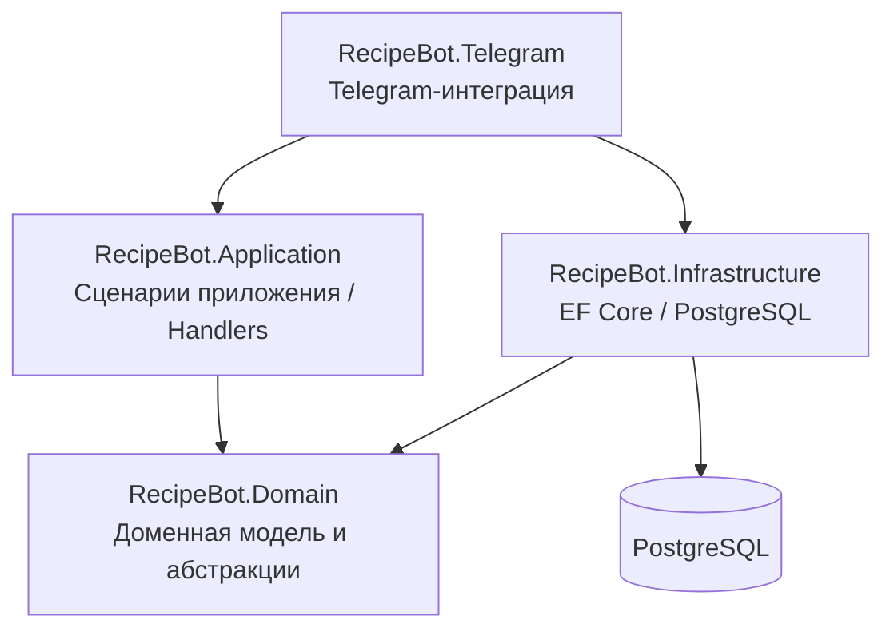
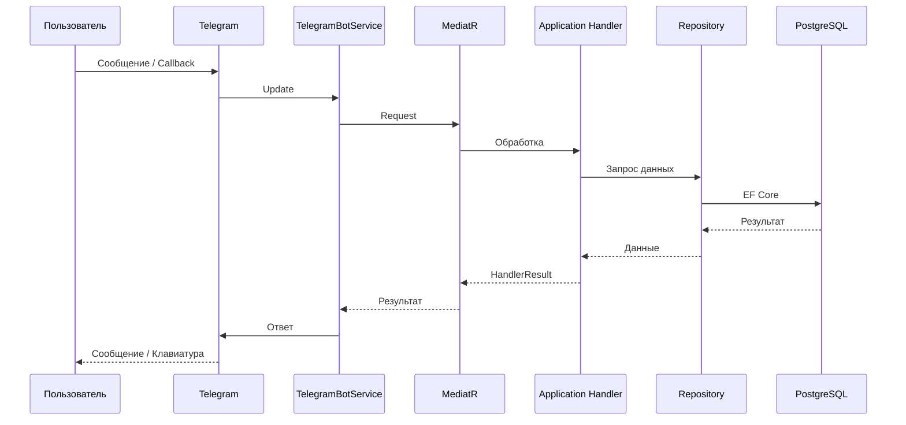
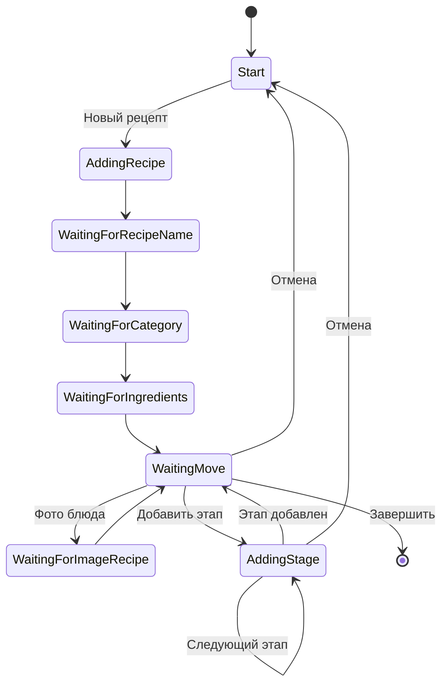
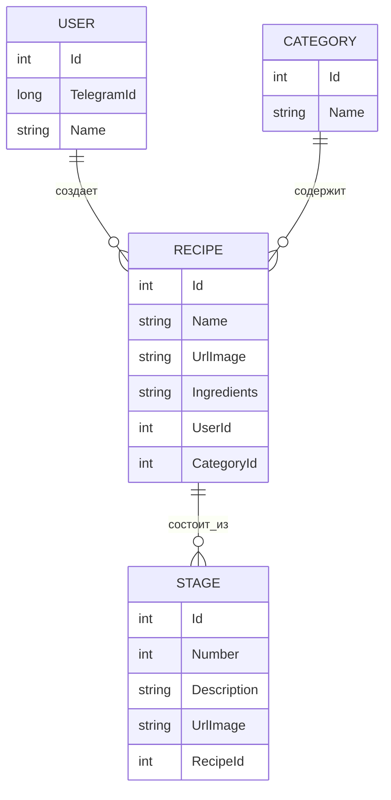

# 🍳 Recipe Telegram Bot

> Telegram-бот для создания и хранения рецептов с пошаговым описанием приготовления и фотографиями.

[](https://dotnet.microsoft.com/)
[](https://learn.microsoft.com/dotnet/csharp/)
[](https://www.postgresql.org/)
[](https://learn.microsoft.com/ef/core/)
[](https://www.docker.com/)
[](https://core.telegram.org/bots/api)
[](#архитектура)

---

## 📌 О проекте

**Recipe Telegram Bot** — учебный backend-проект на современном .NET, предназначенный для создания и хранения рецептов непосредственно через Telegram.

Пользователь взаимодействует с ботом пошагово:

* вводит название рецепта;
* выбирает категорию;
* указывает ингредиенты;
* добавляет фотографию блюда;
* создаёт один или несколько этапов приготовления;
* при необходимости добавляет фотографию к этапу;
* завершает создание рецепта;
* рецепт сохраняется в PostgreSQL.

Основная задача проекта — не только интеграция с Telegram Bot API, но и демонстрация практического применения:

* Clean Architecture;
* Dependency Injection;
* MediatR;
* Entity Framework Core;
* PostgreSQL;
* управления состоянием пользовательского сценария;
* доменной инкапсуляции;
* фоновых сервисов;
* Docker.

---

# ✨ Возможности

### 📝 Создание рецепта

Пользователь проходит последовательный сценарий создания:

```text
/start
   │
   ▼
┌─────────────────────┐
│    Главное меню     │
└──────────┬──────────┘
           │
           ▼
     Новый рецепт
           │
           ▼
   Название рецепта
           │
           ▼
       Категория
           │
           ▼
      Ингредиенты
           │
           ▼
     Фото блюда
      (опционально)
           │
           ▼
 Этапы приготовления
           │
           ▼
       Завершение
           │
           ▼
      PostgreSQL
```

### 📷 Фотографии

Для рецепта можно добавить фотографию блюда.

Для каждого этапа приготовления также можно добавить фотографию.

При этом фотография этапа не является самостоятельным этапом:

```text
📝 Описание этапа
        +
📷 Фотография этапа
```

То есть этап всегда содержит описание, а фотография является дополнительными данными этапа.

---

# 🏗 Архитектура

Проект построен с использованием принципов **Clean Architecture** и разделён на несколько слоёв.



### Слои проекта

#### `RecipeBot.Domain`

Содержит бизнес-модель приложения и абстракции:

* `User`;
* `Recipe`;
* `Stage`;
* `Category`;
* интерфейсы репозиториев;
* состояния приложения.

Доменный слой не зависит от Telegram API или конкретной реализации базы данных.

---

#### `RecipeBot.Application`

Содержит прикладные сценарии и бизнес-логику взаимодействия с пользователем.

Основные компоненты:

* `AddNewRecipeHandler`;
* `StartMenuHandler`;
* `GetOrCreateUserHandler`;
* `UserSession`;
* `HandlerResult`.

Для обработки запросов используется **MediatR**.

---

#### `RecipeBot.Infrastructure`

Отвечает за взаимодействие с PostgreSQL.

Используются:

* Entity Framework Core;
* Npgsql;
* `IDbContextFactory`;
* репозитории;
* EF Core migrations;
* конфигурации сущностей.

---

#### `RecipeBot.Telegram`

Содержит интеграцию с Telegram Bot API.

Основной компонент:

```text
TelegramBotService
```

Он получает обновления Telegram, определяет тип события и передаёт дальнейшую обработку в Application.

---

# 📂 Структура проекта

```text
RecipeBot/
│
├── RecipeBot.Domain/
│   ├── Abstract/
│   │   └── IRepositories/
│   │       ├── ICategoryRepository.cs
│   │       ├── IRecipeRepository.cs
│   │       ├── IStageRepository.cs
│   │       └── IUsersRepository.cs
│   │
│   ├── Enums/
│   │   └── States.cs
│   │
│   └── Models/
│       ├── Category.cs
│       ├── Recipe.cs
│       ├── Stage.cs
│       └── User.cs
│
├── RecipeBot.Application/
│   ├── Handlers/
│   │   ├── AddNewRecipeHandler.cs
│   │   ├── GetOrCreateUser.cs
│   │   └── StatMenu.cs
│   │
│   ├── Models/
│   │   ├── HandlerResult.cs
│   │   └── UserSession.cs
│   │
│   ├── ApplicationExtension.cs
│   └── Dictionaries.cs
│
├── RecipeBot.Infrastructure/
│   ├── EntityTypeConfigurations/
│   ├── Migrations/
│   ├── Repositories/
│   ├── InfraDataExtensions.cs
│   └── MyRecipeDbContext.cs
│
├── RecipeBot.Telegram/
│   ├── BackGroundServices/
│   │   └── TelegramBotService.cs
│   ├── Program.cs
│   ├── Dockerfile
│   └── appsettings.json
│
├── compose.yaml
└── RecipeBot.sln
```

---

# 🔄 Взаимодействие компонентов

Общий сценарий обработки сообщения:



Такой подход позволяет не смешивать Telegram API с логикой сценария создания рецепта.

---

# 🧠 Управление состоянием пользователя

Создание рецепта является последовательным state-based сценарием.

Для каждого Telegram `ChatId` создаётся `UserSession`.

```csharp
public class UserSession
{
    public States UserState { get; set; }
    public States RecipeState { get; set; }
    public Recipe? RecipeDraft { get; set; }
}
```

Сессия хранит:

* текущее состояние пользователя;
* состояние создания рецепта;
* текущий черновик рецепта.

Для хранения активных сессий используется:

```csharp
ConcurrentDictionary<long, UserSession>
```

Таким образом, состояние текущего диалога отделено от постоянных данных, хранящихся в базе.

---

# 🔀 Состояния создания рецепта

Основные состояния сценария:



Явные состояния позволяют однозначно определить, как интерпретировать следующее сообщение пользователя.

---

# 🧩 Доменная модель

Основные связи между сущностями:



Изменение состояния доменных объектов выполняется через методы:

```csharp
recipe.SetName(name);
recipe.SetIngredients(ingredients);
recipe.SetCategoryId(categoryId);
recipe.AddStage(stage);
```

Это позволяет размещать проверки бизнес-инвариантов непосредственно в доменной модели.

---

# 🛠 Технологический стек

| Технология                   | Назначение                             |
| ---------------------------- | -------------------------------------- |
| **.NET 10**                  | Платформа приложения                   |
| **C# 14**                    | Язык программирования                  |
| **Telegram.Bot**             | Работа с Telegram Bot API              |
| **MediatR**                  | Передача запросов application handlers |
| **Entity Framework Core 10** | ORM                                    |
| **PostgreSQL**               | Хранение данных                        |
| **Npgsql**                   | PostgreSQL provider для EF Core        |
| **Docker**                   | Контейнеризация                        |
| **Docker Compose**           | Управление контейнерами                |

---

# 💾 Работа с базой данных

Для работы с PostgreSQL используется Entity Framework Core.

Приложение использует:

```csharp
IDbContextFactory<MyRecipeDbContext>
```

Контекст создаётся непосредственно во время выполнения операции:

```csharp
await using var context =
    await contextFactory.CreateDbContextAsync(cancellationToken);
```

Это позволяет не хранить долгоживущий экземпляр `DbContext` внутри репозитория.

Для изменения структуры базы используются EF Core Migrations.

---

# 💉 Dependency Injection

Регистрация компонентов приложения разделена по слоям.

Основной `Program.cs`:

```text
Program.cs
    │
    ├── AddApplication()
    │
    ├── AddInfra()
    │
    └── AddHostedService<TelegramBotService>()
```

Такой подход позволяет централизовать регистрацию зависимостей каждого слоя.

---

# 🐳 Docker

Telegram-приложение собирается с использованием multi-stage Docker build.

```text
┌───────────────────────┐
│ .NET SDK              │
│ Restore + Build       │
└───────────┬───────────┘
            │
            ▼
┌───────────────────────┐
│ Published application │
└───────────┬───────────┘
            │
            ▼
┌───────────────────────┐
│ .NET Runtime          │
│ RecipeBot.Telegram    │
└───────────────────────┘
```

Запуск:

```bash
docker compose up --build
```

Остановка:

```bash
docker compose down
```

> В текущем `compose.yaml` PostgreSQL не определён отдельным сервисом. Если база также запускается в Docker, приложение должно подключаться к ней по имени Docker-сервиса, а не через `localhost`.

---

# ⚙️ Конфигурация

Для работы приложения необходимы:

* токен Telegram-бота;
* строка подключения к PostgreSQL.

Пример:

```json
{
  "TelegramApiToken": "YOUR_TELEGRAM_BOT_TOKEN",
  "ConnectionStrings": {
    "MyRecipeDb": "Server=localhost;Port=5432;Database=myrecipedb;User Id=myuser;Password=mypassword;"
  }
}
```

## 🔐 Безопасность

Реальные секреты **не должны храниться в Git-репозитории**.

Для локальной разработки рекомендуется использовать:

* .NET User Secrets;
* переменные окружения.

Для Docker/production:

* environment variables;
* Docker Secrets;
* внешний менеджер секретов.

---

# 🗄 Миграции базы данных

Применить существующие миграции:

```bash
dotnet ef database update \
  --project RecipeBot.Infrastructure \
  --startup-project RecipeBot.Telegram
```

Создать новую миграцию:

```bash
dotnet ef migrations add MigrationName \
  --project RecipeBot.Infrastructure \
  --startup-project RecipeBot.Telegram
```

---

# 🚀 Запуск проекта

## Требования

Перед запуском необходимо установить:

* .NET 10 SDK;
* PostgreSQL;
* Docker — опционально;
* Telegram-бота, созданного через BotFather.

---

## Локальный запуск

Восстановить зависимости:

```bash
dotnet restore
```

Собрать решение:

```bash
dotnet build
```

Применить миграции:

```bash
dotnet ef database update \
  --project RecipeBot.Infrastructure \
  --startup-project RecipeBot.Telegram
```

Запустить приложение:

```bash
dotnet run --project RecipeBot.Telegram
```

После запуска бот начинает получать обновления от Telegram.

---

## Запуск через Docker

```bash
docker compose up --build
```

Для остановки:

```bash
docker compose down
```

---

# 🧪 Разработка

Основные команды:

```bash
# Восстановление зависимостей
dotnet restore

# Сборка
dotnet build

# Запуск
dotnet run --project RecipeBot.Telegram
```

---

# 📈 Возможные направления развития

Проект можно расширить следующими возможностями:

* просмотр сохранённых рецептов;
* раздел «Мои рецепты»;
* поиск рецептов;
* редактирование рецептов;
* удаление рецептов;
* пагинация;
* управление категориями;
* хранение пользовательских сессий в Redis;
* вынесение изображений во внешнее файловое хранилище;
* покрытие application и domain логики тестами;
* централизованная обработка ошибок;
* structured logging;
* CI/CD;
* production-ready Docker Compose;
* мониторинг и health checks.

---

# 🎯 Цели проекта

Основная цель проекта — практическое применение современных подходов разработки backend-приложений на .NET.

В проекте отрабатываются:

* Clean Architecture;
* Domain-driven подход к модели;
* Dependency Injection;
* MediatR;
* state-based пользовательские сценарии;
* Entity Framework Core;
* PostgreSQL;
* асинхронное программирование;
* BackgroundService;
* интеграция с внешним API;
* Docker.

---

# 👨‍💻 О проекте

**Recipe Telegram Bot** — pet-проект, ориентированный на практическую демонстрацию backend-разработки на современном .NET.

Несмотря на небольшой предметный домен, проект использует полноценное разделение ответственности между слоями приложения и позволяет продемонстрировать работу с внешним API, базой данных, состоянием пользовательских сценариев и контейнеризацией.

Проект предназначен для учебных и портфолио-целей.

---

## 📄 Лицензия

Проект предназначен для образовательных и портфолио-целей.
